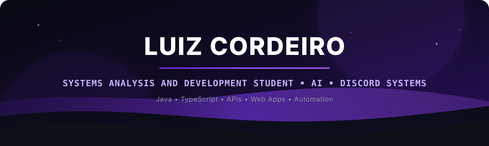

<div align="center">



<br />


</div>

---

## 👨‍💻 Sobre mim

```ts
const luiz = {
  name: "Luiz Cordeiro",
  role: "SYSTEMS ANALYSIS AND DEVELOPMENT STUDENT",
  focus: [
    "Discord Bots",
    "Web Applications",
    "APIs & Integrations",
    "Automation",
    "AI-powered experiences"
  ],
  backend: ["Java", "Node.js"],
  frontend: ["TypeScript", "JavaScript", "HTML", "CSS"],
  database: ["PostgreSQL", "Redis"],
  tools: ["Git", "GitHub", "Maven", "Vercel", "VS Code"],
  currentlyBuilding: "Kayn + Enturma",
  mindset: "Transforming ideas into complete digital products 🚀"
};
```

- ☕ Desenvolvimento de aplicações e bots com **Java**
- 🌐 Criação de aplicações web com **TypeScript / JavaScript**
- 🤖 Bots, automações, APIs e integrações para Discord
- 🗄️ Experiência baixa/média com **PostgreSQL** e **Redis**
- 🎮 Desenvolvimento de recursos para comunidades e experiências gamer
- 🚀 Foco em transformar projetos em produtos completos, utilizáveis e escaláveis
- 🧠 Interesse crescente em **IA aplicada a produtos, automação e experiências interativas**
- ⚙️ Gosto de trabalhar do backend à interface, conectando lógica, dados e experiência do usuário

---

## 🚀 Projeto principal: Kayn

<div align="center">


### Bot multifuncional para Discord

O **Kayn** reúne comunidade, entretenimento, cards, economia, música, moderação, recursos gamer, inteligência artificial e ferramentas para servidores do Discord.

[](https://discord.com/oauth2/authorize?client_id=1485761757145333892&scope=bot&permissions=8)
[](https://www.kayn.online/)
[](https://github.com/luizcordeiro155/KaynDC)

</div>

**Site oficial:** https://www.kayn.online

**Stack principal:** Java 21, JDA 5, Maven, PostgreSQL, Redis, Discord e Vercel.

### Alguns pilares do projeto

- 🎵 Sistema de música e reprodução em servidores
- 🃏 Cards, economia, progressão e recursos de comunidade
- 🤖 Recursos com inteligência artificial e automações
- 🌐 Painel web integrado ao ecossistema do bot
- 🌍 Experiência multilíngue e recursos voltados a comunidades internacionais
- 🔐 Estrutura premium, autenticação e integrações externas
- 🎮 Funcionalidades pensadas para comunidades gamers

---

## 🎓 Projeto em destaque: Enturma

<div align="center">

<a href="https://enturma-flax.vercel.app/">
  
</a>

### Plataforma acadêmica para conectar estudantes

O **Enturma** é uma plataforma multiplataforma que reúne estudos, colaboração, inteligência artificial, comunidade e mobilidade universitária em um único ecossistema.

[](https://enturma-flax.vercel.app/)
[](https://enturma-flax.vercel.app/download)
[](https://github.com/luizcordeiro155/Enturma)

</div>

**Status:** 🟢 Disponível para **Web, Windows e Android** em evolução contínua.

**Plataforma:** https://enturma-flax.vercel.app/

**Código-fonte:** https://github.com/luizcordeiro155/Enturma

**Stack principal:** Java 21, Spring Boot, Next.js, React, TypeScript, PostgreSQL, Electron, Expo, Vercel e Railway.

### Alguns pilares do projeto

- 📚 **Salas de estudo** com mensagens em tempo real, chamadas de voz/vídeo e compartilhamento de tela
- 🤖 **Enturma AI** para apoiar os estudos com cadernos, flashcards e ferramentas de aprendizagem
- 💬 **Comunidade acadêmica**, fórum, perfis, amizades e interações entre estudantes
- 🚗 **Caronas universitárias** para conectar estudantes com trajetos em comum
- 📅 **Organização acadêmica** com materiais e recursos para a rotina universitária
- 💻 **Experiência multiplataforma** com versões Web, Android e Windows

---

## 💻 Linguagens e tecnologias

<div align="center">


</div>

---

## 🛠️ Stack visual

<div align="center">
  
</div>

---

## 💻 Projetos em destaque

<table>
  <tr>
    <td colspan="2" valign="top">
      <h3>🎓 Enturma — plataforma acadêmica multiplataforma</h3>
      <p><a href="https://enturma-flax.vercel.app/"></a></p>
      <p>Projeto disponível para Web, Windows e Android, com salas de estudo, comunicação em tempo real, Enturma AI, comunidade acadêmica e caronas universitárias.</p>
      <p>
        
        
        
        
        
      </p>
      <a href="https://enturma-flax.vercel.app/"><b>Acessar plataforma →</b></a> ·
      <a href="https://github.com/luizcordeiro155/Enturma"><b>Ver código-fonte →</b></a>
    </td>
  </tr>
  <tr>
    <td colspan="2" valign="top">
      <h3>🤖 Kayn — bot multifuncional para Discord</h3>
      <p><a href="https://www.kayn.online/"></a></p>
      <p>Bot ativo para servidores Discord, com música, cards, economia, comunidade, moderação, automações, inteligência artificial e painel web integrado.</p>
      <p>
        
        
        
        
        
      </p>
      <a href="https://www.kayn.online/"><b>Acessar site oficial →</b></a> ·
      <a href="https://discord.com/oauth2/authorize?client_id=1485761757145333892&amp;scope=bot&amp;permissions=8"><b>Adicionar ao Discord →</b></a>
    </td>
  </tr>
  <tr>
    <td colspan="2" valign="top">
      <h3>☀️ Painel Solar — aplicação web para energia solar</h3>
      <p><a href="https://github.com/luizcordeiro155/Painel-Solar"></a></p>
      <p>Aplicação web responsiva desenvolvida para apresentação dos serviços de uma empresa de energia solar, com foco em experiência do usuário, navegação e informações de soluções fotovoltaicas.</p>
      <p>
        
        
        
        
        
      </p>
      <a href="https://github.com/luizcordeiro155/Painel-Solar"><b>Ver repositório →</b></a>
    </td>
  </tr>
  <tr>
    <td width="50%" valign="top">
      <h3>🏥 Planos de Saúde</h3>
      <p>Projeto web criado para apresentação e organização de planos de saúde da empresa SW.</p>
      <p>
        
      </p>
      <a href="https://github.com/luizcordeiro155/Planos-de-saude"><b>Ver repositório →</b></a>
    </td>
    <td width="50%" valign="top">
      <h3>🧩 Ecossistema Kayn</h3>
      <p>Conjunto de aplicações, painéis e serviços que complementam o Kayn e conectam bot, web, dados e experiência do usuário.</p>
      <p>
        
        
        
      </p>
      <a href="https://github.com/luizcordeiro155?tab=repositories"><b>Explorar meus projetos →</b></a>
    </td>
  </tr>
</table>

---

## 📊 GitHub em números

<div align="center">


<br />
<br />


<br />
<br />


</div>

---

## 🐍 Commits

<div align="center">
  <picture>
    <source media="(prefers-color-scheme: dark)" srcset="https://raw.githubusercontent.com/luizcordeiro155/luizcordeiro155/output/github-contribution-grid-snake-dark.svg" />
    <source media="(prefers-color-scheme: light)" srcset="https://raw.githubusercontent.com/luizcordeiro155/luizcordeiro155/output/github-contribution-grid-snake.svg" />
    
  </picture>
</div>

---

## 🎯 Atualmente focado em

- Evoluir a arquitetura e o ecossistema do **Kayn**
- Aprimorar o **Enturma**, disponível para Web, Android e Windows
- Criar experiências mais inteligentes para comunidades online
- Melhorar integrações entre **Discord, web, banco de dados e APIs**
- Aprimorar UI/UX dos produtos que desenvolvo
- Aprofundar conhecimentos em engenharia de software, arquitetura e IA aplicada

---

## 🤝 Conecte-se comigo

<div align="center">

<p>Quer trocar ideias sobre desenvolvimento, projetos, tecnologia ou acompanhar o que estou construindo? Me encontre por aqui:</p>

<a href="https://www.linkedin.com/in/luizthesaint/">
  
</a>
<a href="https://github.com/luizcordeiro155">
  
</a>
<a href="https://www.kayn.online/">
  
</a>
<a href="https://discord.com/oauth2/authorize?client_id=1485761757145333892&scope=bot&permissions=8">
  
</a>
<a href="https://github.com/luizcordeiro155?tab=repositories">
  
</a>

</div>

<br />

<div align="center">
  <h3>💜 Transformando ideias em código e código em experiências.</h3>
  <p><i>Cada projeto é uma oportunidade de aprender, evoluir e construir algo que realmente faça diferença.</i></p>
  <p><b>Obrigado por visitar meu perfil. Volte em breve sempre tem algo novo sendo criado por aqui. 🚀</b></p>

  <br />

  
</div>
